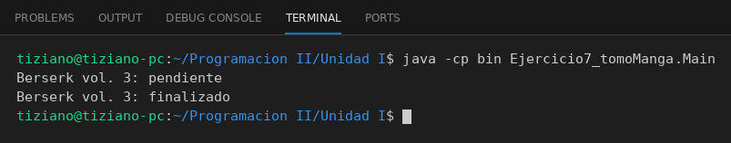

# TomoManga

Programación II - Unidad 1 - Ejercicio 7

## Consigna
Modelar un tomo de manga o cómic de una biblioteca personal y llevar el registro de si ya fue leído.

## Lógica
- **Atributos (privados):** `tituloObra` (String), `numeroVolumen` (int), `precioCompra` (double) y `leido` (boolean).
- **Constructor:** recibe título, volumen y precio; usa los setters para validar y deja `leido` en `false` por defecto.
- **Setters con validación:** `setNumeroVolumen` y `setPrecioCompra` lanzan `IllegalArgumentException` si el valor es negativo.
- **`marcarComoLeido()`:** pasa `leido` a `true`.
- **`estadoLectura()`:** imprime si el tomo está "pendiente" o "finalizado" según `leido`.
- **`Main`:** crea el volumen 3 de Berserk, muestra su estado (pendiente), lo marca como leído y vuelve a mostrarlo (finalizado).

## Ejecución

